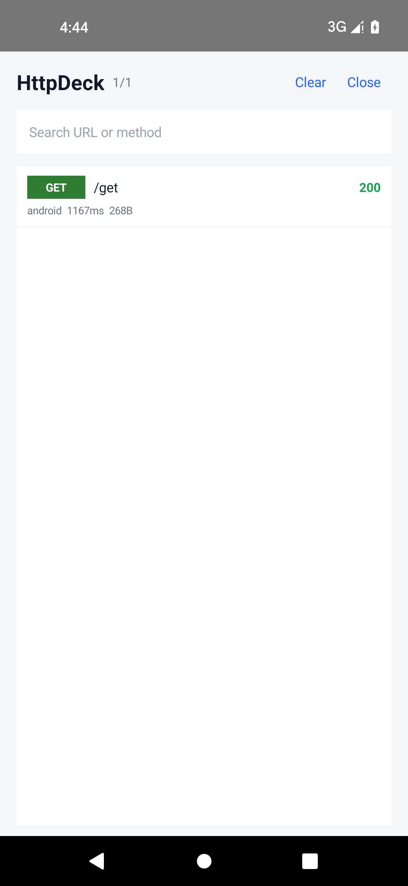

# HttpDeck

> 应用内 HTTP 工作台，面向 Android、Flutter 和混合项目。

[](LICENSE)

**当前状态：`v0.1.0-alpha.1` — Android 捕获内核 + 基础查看界面。** Flutter / Hybrid 在路线图中，API 在 `v0.1.0` 前可能调整。



## 为什么做 HttpDeck

- 默认只在 debug 包生效，正式包默认 no-op；
- 不需要 root、VPN 或 MITM 证书；
- 目标是原生 + Flutter 共用一个面板，混合项目不用装两套工具；
- 展示前默认脱敏 token、Cookie、手机号、签名字段；
- 支持从面板「重新请求」，复用同一个 HTTP 客户端重新签名。

## Alpha 已具备

- OkHttp 拦截器：请求/响应、状态码、耗时、Header、文本 Body；
- 内存环形缓冲（默认 300 条 / 12MB），不落盘；
- Android 基础界面：列表、搜索、详情、分享、复制 cURL、重新请求；
- debug 默认可用；release 需要显式依赖真实包并设置 `enableInRelease = true`；
- 脱敏、存储、拦截器、重新请求构造的单测。

暂未包含：Compose UI、桌面宠物入口、Flutter 包、Hybrid bridge、HAR、WebSocket、Mock/对比。

## Android 接入

### 1. 添加仓库

```groovy
// settings.gradle
dependencyResolutionManagement {
    repositories {
        google()
        mavenCentral()
        maven { url 'https://raw.githubusercontent.com/kevin321happy/httpdeck/main/docs/maven' }
    }
}
```

### 2. 添加依赖

```groovy
dependencies {
    debugImplementation 'io.github.kevin321happy:httpdeck-android:0.1.0-alpha.1'
    releaseImplementation 'io.github.kevin321happy:httpdeck-android-noop:0.1.0-alpha.1'
}
```

`-noop` 与真实包 API 完全一致，但 release 中不做任何事。

### 3. 安装到 OkHttp

```kotlin
val builder = OkHttpClient.Builder()
HttpDeck.install(application, builder)

val client = builder.build()
```

Retrofit 使用同一个 client：

```kotlin
Retrofit.Builder()
    .baseUrl("https://api.example.com/")
    .client(client)
    .build()
```

必须在 `builder.build()` 之前调用 `install`。

### 4. 打开面板

```kotlin
HttpDeck.show(activity)
```

建议放在你自己的隐藏入口里，例如长按版本号。

### Release 抓包（仅受控构建）

```groovy
// releaseImplementation 'io.github.kevin321happy:httpdeck-android:0.1.0-alpha.1'
```

```kotlin
HttpDeck.install(
    application = application,
    builder = builder,
    config = HttpDeckConfig(enableInRelease = true)
)
```

本地隐藏开关**不是安全边界**，拿到 APK 的人仍可能开启。不要在没有远程白名单 / kill switch 的情况下把它放进公开商店包。

详细步骤见 [docs/quickstart-android.md](docs/quickstart-android.md)。

## 从源码构建

要求：JDK 17、Android SDK 34，仓库自带 Gradle wrapper。

```bash
./gradlew :httpdeck-core:test
./gradlew :sample-android:assembleDebug
```

安装 sample，点 **GET**，再点 **Open HttpDeck**。

## 目录

```text
httpdeck-core/          Kotlin/JVM：记录模型、存储、脱敏、OkHttp 拦截器、重新请求构造
httpdeck-android/       Android 库：HttpDeck facade、查看界面
httpdeck-android-noop/  Release 空实现
sample-android/         可运行的原生示例
docs/                   快速接入、设计 spec、截图
```

## 捕获边界

只捕获安装到 OkHttp client 上的流量。WebView、第三方 SDK 自建网络栈、裸 TCP/TLS、Flutter Dart HTTP 栈不在 alpha 范围内（Flutter 会单独支持）。

## 安全

- 默认 debug-only、内存-only、不上传、不落盘；
- 展示/分享/cURL 默认脱敏；
- release 抓包窗口启用 `FLAG_SECURE`，关闭开关立即清空；
- 不要把抓包内容发到公开渠道；公开包开启 release 抓包前必须做安全评审。

## 路线图

- `v0.1.0`：Flutter 包 + Hybrid bridge、Compose UI、桌面宠物入口、HAR/JSON 导出。
- `v0.2`：WebSocket、Mock/对比、Dio 4、Ktor/http 适配。
- `v1.0`：API 稳定、Maven Central、pub.dev。

## License

Apache-2.0，见 [LICENSE](LICENSE)。